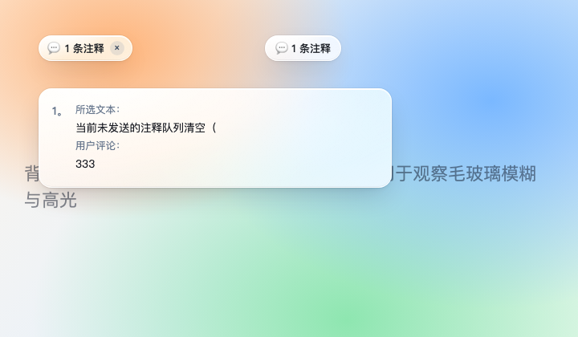
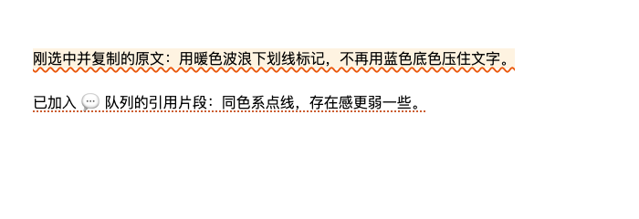

# dsh-selection-quote-auto

**选中即复制 + 「注释」浮框** —— [DeepSeek Harness](https://github.com/deepseek-ai/deepseek-harness)（dsh）的划词引用与批注增强插件，基于 [xt765/dsh-selection-quote](https://github.com/xt765/dsh-selection-quote) 0.2.0 的本地增强版（MIT）。

选一段助手回复里的文字，原文自动进剪贴板，选区上方直接弹出「注释」小胶囊；点它才展开原来的评论输入框。右键菜单和 `⌘L` 全部保留。

> A fork of [dsh-selection-quote](https://github.com/xt765/dsh-selection-quote) for DeepSeek Harness: selecting text in an assistant message copies it and shows a small **Comment** chip; clicking the chip opens the inline comment box. Right-click menu and `⌘L` still work. Web profile only (`dsh.client.platform = "web"`).

## 和上游的区别

| | 上游 0.2.0 | 本插件 |
| --- | --- | --- |
| 触发 | 选中后右键，或按 `⌘L` | 选中即**自动复制原文**，并在选区上方弹「注释」胶囊；右键 / `⌘L` 仍可用 |
| 复制 | 右键菜单里的「拷贝」 | 选中即复制，浮框右侧短暂显示「已复制」 |
| 标记 | 蓝色背景高亮 | 暖色波浪下划线（待确认）/ 点线（已进队列），不遮挡正文 |
| 深色模式 | 跟随系统 `prefers-color-scheme`，与 DSH 主题可能不一致 | 跟随 DSH 的 `body[data-ds-dark-theme]` |
| 外观 | 深色胶囊/卡片 | 白色液态玻璃（浅色主题）/ 烟熏玻璃（深色主题） |
| 角标 | 滚动时靠 React 重渲染，惯性滚动会拖影 | rAF 直接同步坐标，滚动时贴在文字旁；越界自动隐藏 |
| 范围 | 会话内任意消息 | 默认仅助手消息（`AUTO_TRIGGER_SCOPE` 可切换） |




## 安装

```sh
dsh plugin --profile web add dsh-selection-quote-auto
```

装完刷新页面（新 bundle 通常需要重启一次 `dsh web`）。也可以在 DSH 的插件市场/发现页里搜索 `dsh-selection-quote-auto`。

> ⚠️ **先卸载或停用上游 `dsh-selection-quote`**，两者会往同一个位置渲染浮框，同时启用会重复出现两套 UI。

## 使用

1. 在助手回复里选中 ≥2 个字 → 原文自动复制，选区上方出现「注释」；
2. 点「注释」→ 评论输入框出现（自动聚焦），可写批注，留空也行；
3. `Enter` 或 ✓ → 底部输入框出现 `💬 N 条注释 ×`，`Enter` 发送；
4. 右键菜单（拷贝 / 添加到对话 `⌘L`）、序号角标、已发送消息的 `N 条注释` 胶囊都保持原样。

## 配置

插件本身读取宿主配置 `enabled` / `addToChatMode` / `commentLabel`；行为常量在 `lib/client.js` 顶部（改动后刷新页面即生效）：

```js
const AUTO_COPY_ON_SELECT = true;       // 选中即复制原文
const AUTO_TRIGGER_ON_SELECT = true;    // 选中即显示「注释」胶囊
const AUTO_TRIGGER_SCOPE = "assistant"; // "assistant" 仅助手消息；"any" 所有会话消息
const COPIED_HINT_MS = 1600;            // 「已复制」提示时长
```

## 兼容

- DSH `0.2.x` web profile（`dsh web`），Chromium 内核浏览器；持久下划线依赖 CSS Custom Highlight API（Chrome/Edge 105+、Safari 17.2+），不支持时优雅降级。
- 宿主侧只注入 `conversation.input.overlay` / `conversation.input.dock` / `conversation.user.text.node` 三个既有插槽，不改 DSH 核心。

## 开发与回归

```sh
node --test test/index.test.js
```

`test/dom-harness.html`（Range 失效重定位）、`test/pin-scroll-harness.html`（滚动跟随）可用 headless Chrome 打开查看 OK/FAIL 输出。

## 来源与许可

- 上游：[xt765/dsh-selection-quote](https://github.com/xt765/dsh-selection-quote) 0.2.0（MIT，© 2026 xt765）
- 本仓库的修改（自动复制、注释浮框、标记样式、深色主题修正、角标滚动跟随、液态玻璃外观）© 2026 prettyfox，同样以 MIT 发布，见 [LICENSE](./LICENSE)。

本插件是独立分叉，与上游作者无隶属关系；安装即运行第三方代码，请自行检查源码。
